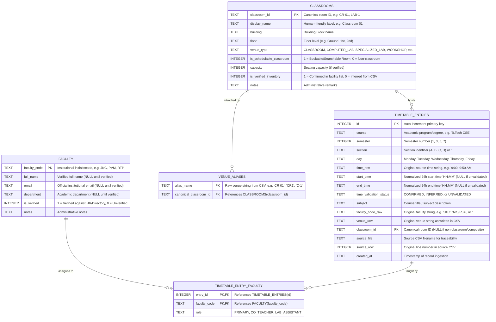

# Classroom Finder — Relational Database Schema Design

This document specifies the database architecture, schema design, entity relationships, query patterns, and data integrity rules for the **Classroom Finder** application.

---

## 1. Executive Summary & Architectural Overview

The Classroom Finder application enables students and faculty to:
1. Search scheduled classes by academic cohort (course, semester, section), day, time, or venue.
2. Identify rooms that have **no scheduled classes** during a specific time interval.
3. Look up faculty teaching schedules and contact information using faculty codes or verified names.

To achieve this reliably, the raw and merged timetable data (from `master_timetable.csv`) must be structured into a normalized relational model. The schema prioritizes:
- **Traceability:** Every record maintains a direct pointer to its original source file and source row.
- **Data Integrity:** Strict constraints, explicit foreign keys, and typed columns prevent corrupted or orphaned records.
- **Truthful Availability:** Distinguishing clearly between "no scheduled class in the academic timetable" and "confirmed physically vacant."
- **Separation of Concerns:** Distinguishing the operational timetable logs from physical classroom inventories and verified faculty directories.

---

## 2. Entity-Relationship (ER) Diagram



---

## 3. Relational Schema Specification (DDL)

The schema is designed for **SQLite 3** (and directly portable to PostgreSQL / MySQL). SQLite uses dynamic typing with storage classes (`TEXT`, `INTEGER`, `REAL`, `BLOB`), and requires enabling foreign keys via `PRAGMA foreign_keys = ON;`.

### 3.1 Table: `classrooms`
Represents the verified inventory of physical rooms and venues. It distinguishes actual academic classrooms and labs from general campus facilities or non-physical placeholders.

```sql
CREATE TABLE classrooms (
    classroom_id             TEXT PRIMARY KEY,
    display_name             TEXT NOT NULL,
    building                 TEXT,
    floor                    TEXT,
    venue_type               TEXT NOT NULL CHECK (
                                 venue_type IN (
                                     'CLASSROOM',
                                     'COMPUTER_LAB',
                                     'SPECIALIZED_LAB',
                                     'WORKSHOP',
                                     'DRAWING_HALL',
                                     'SEMINAR_HALL',
                                     'SPORTS_OUTDOOR',
                                     'NON_PHYSICAL',
                                     'COMPOSITE_OTHER'
                                 )
                             ),
    is_schedulable_classroom INTEGER NOT NULL DEFAULT 1 CHECK (is_schedulable_classroom IN (0, 1)),
    capacity                 INTEGER CHECK (capacity IS NULL OR capacity > 0),
    is_verified_inventory    INTEGER NOT NULL DEFAULT 0 CHECK (is_verified_inventory IN (0, 1)),
    notes                    TEXT
);
```

### 3.2 Table: `venue_aliases`
Maps the 115 raw venue spellings discovered in Phase 1 (e.g. `CR-01`, `CR 01`, `CR1`, `C1`, `C-1`) to a single canonical `classroom_id`.

```sql
CREATE TABLE venue_aliases (
    alias_name             TEXT PRIMARY KEY,
    canonical_classroom_id TEXT NOT NULL REFERENCES classrooms(classroom_id)
                           ON UPDATE CASCADE
                           ON DELETE RESTRICT
);
```

### 3.3 Table: `faculty`
Represents instructors. In keeping with the project constraints, full names and departments are **never invented**; they remain `NULL` until confirmed by official institutional records.

```sql
CREATE TABLE faculty (
    faculty_code  TEXT PRIMARY KEY,
    full_name     TEXT,
    email         TEXT,
    department    TEXT,
    is_verified   INTEGER NOT NULL DEFAULT 0 CHECK (is_verified IN (0, 1)),
    notes         TEXT
);
```

### 3.4 Table: `timetable_entries`
The core operational table containing all 711 processed timetable schedule rows, retaining both source traceability and validated normalized search fields.

```sql
CREATE TABLE timetable_entries (
    id                      INTEGER PRIMARY KEY AUTOINCREMENT,
    course                  TEXT NOT NULL,
    semester                INTEGER NOT NULL CHECK (semester BETWEEN 1 AND 12),
    section                 TEXT NOT NULL DEFAULT '',
    day                     TEXT NOT NULL CHECK (
                                day IN ('Monday', 'Tuesday', 'Wednesday', 'Thursday', 'Friday', 'Saturday', 'Sunday')
                            ),
    time_raw                TEXT NOT NULL,
    start_time              TEXT CHECK (start_time IS NULL OR start_time GLOB '[0-2][0-9]:[0-5][0-9]'),
    end_time                TEXT CHECK (end_time IS NULL OR end_time GLOB '[0-2][0-9]:[0-5][0-9]'),
    time_validation_status  TEXT NOT NULL DEFAULT 'UNVALIDATED' CHECK (
                                time_validation_status IN ('CONFIRMED', 'INFERRED', 'UNVALIDATED')
                            ),
    subject                 TEXT NOT NULL,
    faculty_code_raw        TEXT NOT NULL DEFAULT '',
    venue_raw               TEXT NOT NULL,
    classroom_id            TEXT REFERENCES classrooms(classroom_id)
                            ON UPDATE CASCADE
                            ON DELETE SET NULL,
    source_file             TEXT NOT NULL,
    source_row              INTEGER NOT NULL,
    created_at              TEXT NOT NULL DEFAULT (datetime('now')),

    -- Start time must strictly precede end time when both are populated
    CONSTRAINT chk_time_order CHECK (
        (start_time IS NULL AND end_time IS NULL) OR
        (start_time IS NOT NULL AND end_time IS NOT NULL AND start_time < end_time)
    )
);
```

### 3.5 Table: `timetable_entry_faculty`
A junction table that connects individual timetable entries to one or more faculty codes. This handles co-teaching scenarios discovered in the raw data (e.g. `NIS/RJA`, `PRY / ABP / DDG`) so that searching for either instructor returns the lecture.

```sql
CREATE TABLE timetable_entry_faculty (
    entry_id     INTEGER NOT NULL REFERENCES timetable_entries(id) ON DELETE CASCADE,
    faculty_code TEXT NOT NULL REFERENCES faculty(faculty_code) ON DELETE RESTRICT,
    role         TEXT NOT NULL DEFAULT 'PRIMARY' CHECK (role IN ('PRIMARY', 'CO_TEACHER', 'LAB_ASSISTANT')),
    PRIMARY KEY (entry_id, faculty_code)
);
```

---

## 4. Indexing Strategy

Fast query response is vital for a responsive web search interface. The following indexes are tailored to the primary search access patterns:

```sql
-- 1. Accelerates interval overlap and room availability queries by day
CREATE INDEX idx_timetable_availability
ON timetable_entries (day, start_time, end_time, classroom_id)
WHERE start_time IS NOT NULL AND end_time IS NOT NULL;

-- 2. Accelerates room schedule lookups (e.g. "What is happening in CR-01 on Tuesday?")
CREATE INDEX idx_timetable_room_day
ON timetable_entries (classroom_id, day, start_time);

-- 3. Accelerates cohort timetable lookups (e.g. "Show timetable for B.Tech CSE Sem 3 Sec A")
CREATE INDEX idx_timetable_cohort
ON timetable_entries (course, semester, section, day);

-- 4. Accelerates raw faculty searches and source traceability lookups
CREATE INDEX idx_timetable_faculty_raw ON timetable_entries (faculty_code_raw);
CREATE INDEX idx_timetable_source ON timetable_entries (source_file, source_row);

-- 5. Accelerates reverse faculty lookups via the junction table
CREATE INDEX idx_entry_faculty_code ON timetable_entry_faculty (faculty_code);
```

---

## 5. Example SQL Queries

### Query 1: Search Classes by Day and Time
*Use case:* A student wants to know what classes are scheduled on **Monday between 10:00 and 11:50 AM** in **CR-01**, or across the entire college.

```sql
SELECT 
    t.course,
    t.semester,
    t.section,
    t.day,
    t.time_raw,
    t.start_time,
    t.end_time,
    t.subject,
    t.faculty_code_raw,
    COALESCE(c.display_name, t.venue_raw) AS venue_name,
    t.source_file,
    t.source_row
FROM timetable_entries t
LEFT JOIN classrooms c ON t.classroom_id = c.classroom_id
WHERE t.day = 'Monday'
  -- Checks for temporal overlap with requested window 10:00 to 11:50
  AND t.start_time < '11:50'
  AND t.end_time   > '10:00'
ORDER BY t.start_time, t.course, t.section;
```

---

### Query 2: Find Venues Without Scheduled Classes During an Interval
*Use case:* A study group or student club wants to find all **actual classrooms** that have **no scheduled class on Tuesday between 11:00 and 12:00**.

```sql
SELECT 
    c.classroom_id,
    c.display_name,
    c.building,
    c.floor,
    c.venue_type,
    c.capacity
FROM classrooms c
WHERE c.is_schedulable_classroom = 1
  -- Room must not have ANY overlapping scheduled class in the requested interval
  AND NOT EXISTS (
      SELECT 1
      FROM timetable_entries t
      WHERE t.classroom_id = c.classroom_id
        AND t.day = 'Tuesday'
        AND t.start_time < '12:00'
        AND t.end_time   > '11:00'
  )
ORDER BY c.building, c.classroom_id;
```

> [!NOTE]
> Rooms with unvalidated or missing normalized times are deliberately surfaced in diagnostic alerts so they are never falsely assumed to be vacant.

---

### Query 3: Search for a Faculty Member by Code or Verified Name
*Use case:* A student searches for instructor `"JKC"` or verified name `"Dr. Sharma"`.

```sql
SELECT 
    t.day,
    t.time_raw,
    t.subject,
    t.course,
    t.semester,
    t.section,
    COALESCE(c.display_name, t.venue_raw) AS venue,
    f.faculty_code,
    COALESCE(f.full_name, 'Name Pending Verification') AS faculty_name,
    t.source_file
FROM timetable_entries t
JOIN timetable_entry_faculty tef ON t.id = tef.entry_id
JOIN faculty f ON tef.faculty_code = f.faculty_code
LEFT JOIN classrooms c ON t.classroom_id = c.classroom_id
WHERE f.faculty_code = 'JKC' 
   OR f.full_name LIKE '%Sharma%'
ORDER BY 
    CASE t.day 
        WHEN 'Monday' THEN 1 
        WHEN 'Tuesday' THEN 2 
        WHEN 'Wednesday' THEN 3 
        WHEN 'Thursday' THEN 4 
        WHEN 'Friday' THEN 5 
        ELSE 6 
    END,
    t.start_time;
```

---

## 6. Time Interval Overlap & Ambiguous Time Handling

### 6.1 The Mathematical Overlap Principle
Two time intervals $[Start_A, End_A)$ and $[Start_B, End_B)$ overlap if and only if:
$$\text{Overlap} \iff (Start_A < End_B) \land (End_A > Start_B)$$

#### Why Strict Inequality (`<` and `>`) is Required:
In academic scheduling, consecutive classes are adjacent:
- Class 1: `09:00` to `09:50`
- Class 2: `10:00` to `10:50` (or `09:50` to `10:40`)

If class A ends at `10:00` and class B starts at `10:00`, they **do not overlap**. Using strict `<` and `>` correctly evaluates that $10:00 < 10:00$ is false, confirming that the room is available for class B once class A concludes.

### 6.2 The AM/PM Ambiguity Problem in the Dataset
Inspection of the 711 rows in `master_timetable.csv` revealed exactly **50 distinct time strings**:
- **25 strings include AM/PM:** e.g. `'9:00–9:50 AM'`, `'11:00 AM–1:50 PM'`, `'3:00–3:50 PM'`.
- **25 strings lack AM/PM:** e.g. `'9:00–9:50'`, `'11:00–1:50'`, `'1:00–1:50'`, `'4:00–4:50'`.

#### Strict Policy on Time Normalization:
Per project rules: **Never guess or infer AM/PM values without explicit evidence.**

To handle this cleanly:
1. `time_raw` preserves the exact original text (e.g. `'1:00–1:50'`).
2. When importing:
   - Strings with explicit AM/PM are converted to 24-hour format (`'13:00'`, `'13:50'`) and marked `time_validation_status = 'CONFIRMED'`.
   - Strings lacking AM/PM are initially left with `start_time = NULL` and `end_time = NULL`, marked `time_validation_status = 'UNVALIDATED'`.
   - Once the project team formally approves the standard daytime college operating rules (e.g. times from 1:00 to 6:00 represent afternoon PM slots), an automated batch rule updates them to `time_validation_status = 'INFERRED'`.
3. Overlap queries evaluate only records where `start_time IS NOT NULL AND end_time IS NOT NULL`. Any query checking room availability displays a banner:
   *"Availability calculated from 393 confirmed slots; 318 unvalidated slots excluded pending team rule approval."*

---

## 7. Crucial Distinction: "No Timetable Booking" vs. "Confirmed Physically Vacant"

A central requirement for the Classroom Finder application is to avoid misleading students into walking into a locked room or an ongoing event.

```text
┌────────────────────────────────────────────────────────────────────────┐
│                        PHYSICAL REALITY ON CAMPUS                      │
│                                                                        │
│   ┌────────────────────────────────┐   ┌───────────────────────────┐   │
│   │   Master Academic Timetable    │   │  Unscheduled Real-World   │   │
│   │   Scheduled Lectures (711)     │   │  Campus Activities        │   │
│   │                                │   │                           │   │
│   │  • Regular semester courses    │   │  • Midterm/Final Exams    │   │
│   │  • Lab sessions                │   │  • Guest Lectures         │   │
│   │  • Designated tutorial rooms   │   │  • Student Club Meetings  │   │
│   │                                │   │  • Maintenance / Painting │   │
│   │                                │   │  • Locked Rooms ('Lock')  │   │
│   │                                │   │  • Ad-hoc Faculty Usage   │   │
│   └────────────────────────────────┘   └───────────────────────────┘   │
└────────────────────────────────────────────────────────────────────────┘
```

### The Open-World Assumption
In database theory, the **Closed-World Assumption** presumes that anything not recorded in the database is false (i.e. if no class is in the database, the room is empty). 

For a university campus, this assumption is false. We operate under the **Open-World Assumption**:
1. The 36 CSV files cover **only regular odd-semester academic lectures**.
2. They do not record:
   - Ad-hoc club activities or hackathons.
   - Examination seatings.
   - Physical room locking status (e.g. `B.Tech CSE, Sem 3 - Section B.csv` row 6 explicitly lists a slot titled `'Lock'` at venue `'Campus'`).
   - Facilities maintenance or equipment repairs.

### Web Application UI Requirements
The user interface must never present a room with a green badge saying **"Guaranteed Empty"** or **"Confirmed Vacant"**.
Instead, it must use transparent, truthful language:
- **Recommended Label:** `"No Scheduled Class"` or `"Timetable Free"`.
- **Tooltip/Disclaimer:** *"Based on regular semester timetable records. Subject to departmental reservations, exams, and room key access."*

---

## 8. Safe CSV-to-SQLite Import Plan

The import process from `data/processed/master_timetable.csv` into SQLite must be repeatable, atomic, and completely safe.

### Phase 1: Pre-Import Verification
1. Verify SHA-256 baseline checksums of `data/raw/` to ensure raw files are completely untouched.
2. Verify that `data/processed/master_timetable.csv` exists, has exactly 10 headers, and has non-zero records.

### Phase 2: Transactional Ingestion (Atomic Operation)
```text
BEGIN TRANSACTION;
  1. Initialize SQLite tables and indexes.
  2. Ingest master_timetable.csv records directly into timetable_entries.
  3. Extract distinct faculty codes into faculty table (marking full_name as NULL, is_verified as 0).
  4. Parse composite faculty codes (e.g. 'NIS/RJA') and populate timetable_entry_faculty.
  5. Extract distinct venues into venue_aliases.
  6. Reconcile known venues against classrooms master inventory.
  7. Run verification checks (row counts, foreign keys).
IF any check fails:
  ROLLBACK; (Database remains clean and unaffected)
ELSE:
  COMMIT;
```

### Phase 3: Post-Import Integrity Audit
- Run `PRAGMA foreign_key_check;` to verify relational integrity.
- Verify that `COUNT(*)` in `timetable_entries` equals exactly `711`.
- Verify that exactly `1` row has empty faculty code (`B.Tech CSE, Sem 3 - Section B.csv`, row 6).

---

## 9. Assumptions, Unresolved Questions & Decisions Requiring Approval

The following items require explicit project team review and formal approval before implementation:

### Decision 1: Formal 12-Hour to 24-Hour Normalization Rule
- *Observation:* 25 out of 50 time strings (318 rows) lack AM/PM designations (e.g. `1:00–1:50`, `9:00–9:50`, `11:00–1:50`).
- *Proposal:* Adopt standard university operating hours rule:
  - Hours `8:00` to `11:59` are AM (`08:00` to `11:59`).
  - Hour `12:00` to `12:59` is PM (`12:00` to `12:59`).
  - Hours `1:00` to `7:59` are PM (`13:00` to `19:59`).
- *Requires Approval:* Should the team authorize this conversion rule and promote these rows from `'UNVALIDATED'` to `'CONFIRMED'`?

### Decision 2: Canonical Classroom Room Naming Standard
- *Observation:* Classroom 1 appears in 7 different spelling variations: `CR-01`, `CR 01`, `CR1`, `CR-1`, `CR 1`, `C1`, `C-1`.
- *Proposal:* Standardize all numbered classrooms to hyphenated uppercase format: `CR-01`, `CR-02`, ..., `CR-14`.
- *Requires Approval:* Approval of the canonical room naming convention.

### Decision 3: Categorization of Non-Classroom Venues
- *Observation:* Venues include `Campus`, `Online`, `OD/CR 04`, `OD/GYM/CR04`, and `GYM / OD1 / OD2 / CR 01`.
- *Proposal:*
  - `Campus` and `Online` are marked `is_schedulable_classroom = 0` and `venue_type = 'NON_PHYSICAL'`.
  - Outdoor/Gym entries are marked `is_schedulable_classroom = 0` and `venue_type = 'SPORTS_OUTDOOR'`.
  - When searching for free classrooms, these non-classroom venues are filtered out automatically.
- *Requires Approval:* Confirmation of which venue types should be hidden from classroom availability searches.

### Decision 4: Source for Verified Faculty Names
- *Observation:* All 72 faculty identifiers in the timetable are 3-letter or 4-letter initials (e.g. `JKC`, `PVM`, `ABTh`).
- *Constraint:* The team explicitly prohibits inventing or guessing full names.
- *Requires Approval:* How will the official faculty directory (mapping initials to full name, title, and email) be provided to the project?

---

## 10. Beginner-Friendly Explanation: How the Tables Work Together

Think of the database as three distinct reference binders in a university administration office:

1. **The Campus Building Blueprint (`classrooms`):**
   This table is a list of every physical room that physically exists on campus. It records what kind of room it is (a regular lecture room, a computer lab, an art studio, or an outdoor field) and whether students can use it for studying.

2. **The Faculty Directory (`faculty`):**
   This table is the staff directory. It records each teacher's initials (`faculty_code`). Until the university HR department gives us their verified full names and emails, we keep those fields blank rather than guessing.

3. **The Master Timetable Ledger (`timetable_entries`):**
   This is the giant master schedule book. Every row represents a scheduled class. Instead of repeating the room description or teacher details 700 times, each row simply points to the room in the *Building Blueprint* and the teacher in the *Faculty Directory*.

### How Searching Works:
- When a student asks: *"Is Classroom CR-01 free on Monday at 10:15 AM?"*
- The database checks the *Building Blueprint* to confirm `CR-01` is a real classroom.
- Then it looks at the *Master Timetable Ledger* for any entry that matches `CR-01` on `Monday` whose time covers `10:15`.
- If no class is scheduled, the application reports: *"No scheduled lecture found in the timetable."*
- Because each ledger entry preserves the original filename and line number, anyone can trace any search result directly back to the original professor's spreadsheet!
